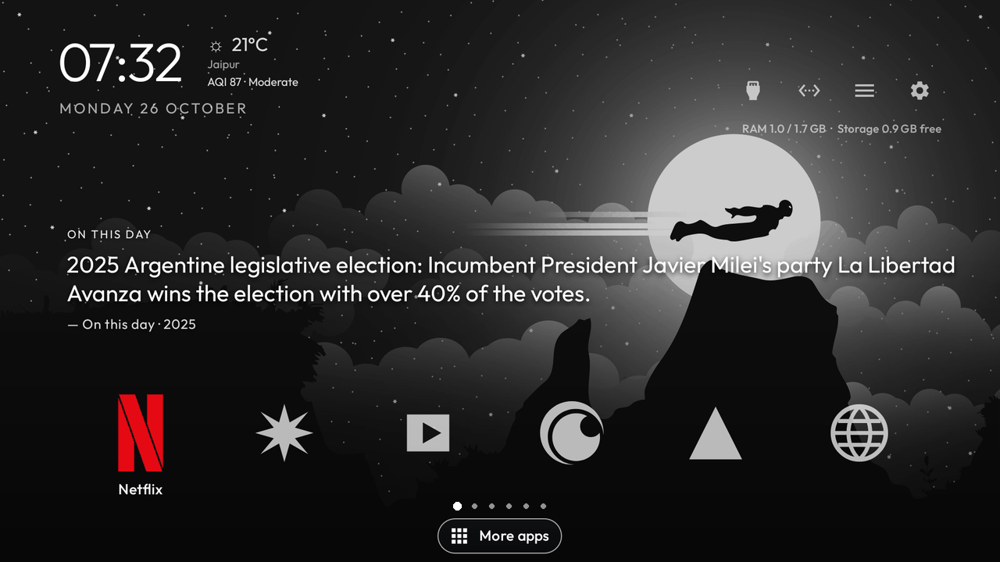

# KinoDock

A customizable Android home launcher for TV remotes: a favorites dock, full app library, dark cinematic Home screen, and optional live information cards.

## Screenshots

Home screenshot carousel. It shows one full screen at a time, including the On This Day card, and the highlighted dot advances with each image:



Individual stills: [plain](screenshots/home.png) · [Batman demo](screenshots/home-batman-wallpaper.png) · [forest](screenshots/wallpaper-pine-light.png) · [city at night](screenshots/wallpaper-night-city.png) · [neon city](screenshots/wallpaper-neon-street.png) · [On This Day](screenshots/on-this-day.png)

## Features

- Customizable favorites row, with other installed apps available in the scrollable App Library.
- Remote-friendly focus, navigation, app ordering, and launcher settings.
- Dark wallpaper backgrounds with optional Unsplash search and a six-hour rotation. Images are streamed and kept in memory rather than saved as wallpaper files.
- Home cards for mixed quotes, Currents headlines, and On This Day history.
- Weather and AQI, sleep timer controls, wallpaper selection, and a compact RAM/storage readout.
- Cached API data and timeouts so network failures keep the launcher usable.

## Build

### Requirements

- Android Studio or Android SDK command-line tools
- JDK 17
- Android SDK Platform 34

From the repository root:

```sh
cp launcher/local.properties.example launcher/local.properties
# Keep or add the sdk.dir entry created by Android Studio.
./launcher/gradlew -p launcher assembleDebug
```

The debug APK is written to `launcher/app/build/outputs/apk/debug/app-debug.apk`.

For a release build:

```sh
./launcher/gradlew -p launcher assembleRelease
```

Release builds intentionally contain empty Unsplash and Currents API key fields. Those API-backed features stay unavailable until a release-safe key-provisioning approach is added. Never publish an APK built with private developer keys.

## API keys

The source repository has no API key values. To use Unsplash and Currents in a personal debug build, add **your own** keys to `launcher/local.properties`:

```properties
UNSPLASH_ACCESS_KEY=your_own_unsplash_access_key
CURRENTS_API_KEY=your_own_currents_api_key
```

`local.properties` is ignored by Git. Android packages are inspectable: a key included in a debug APK can be extracted. Keep that APK private and use only your own keys. Public release builds override both fields to empty strings. See [SECURITY.md](SECURITY.md).

ZenQuotes and SlashYear are called without API keys and their data is cached. Check each provider's current usage and attribution terms before redistributing a build or using a different account.

## Install on a device

Enable Developer options and USB debugging, connect with ADB, then run:

```sh
adb connect DEVICE_IP:5555
adb install -r launcher/app/build/outputs/apk/debug/app-debug.apk
```

Open the launcher from the device's app list and select it as Home if Android asks.

## Project notes

See [PROJECT_NOTES.md](PROJECT_NOTES.md) for implementation details, API refresh behavior, caching/failure handling, and the recent UI changes. See [THIRD_PARTY_NOTICES.md](THIRD_PARTY_NOTICES.md) for bundled font and branding notes.

## License

The project source is under the MIT License in [LICENSE](LICENSE). The Outfit typeface has its own SIL Open Font License notice at [launcher/FONT-LICENSE-OFL.txt](launcher/FONT-LICENSE-OFL.txt). Trademarks and third-party API content remain subject to their owners' terms.

## Credits and inspiration

KinoDock was inspired by the [CleanYourTV project](https://github.com/Gathin23/cleanyourtv), especially its Android TV launcher concept and focus on a clean, customizable TV home screen.

The Batman wallpaper appears in a screenshot for demonstration purposes only. It is from [WallpaperCave](https://wallpapercave.com/); the original wallpaper file is not included in this repository.

The three non-Batman wallpapers shown in the screenshots are by [Ben Griffiths](https://unsplash.com/@benofthenorth), [Clark Gu](https://unsplash.com/@atluminon), and [Kevin Laminto](https://unsplash.com/@kxvn_lx), respectively. See their [Unsplash photo pages](https://unsplash.com/photos/glowing-light-in-dark-pine-forest-l7R85WBKl1c), [photo page](https://unsplash.com/photos/a-night-view-of-a-city-with-a-lot-of-lights--U_4hQkicyM), and [photo page](https://unsplash.com/photos/people-walking-on-walkway-during-nighttime-7PqRZK6rbaE).
